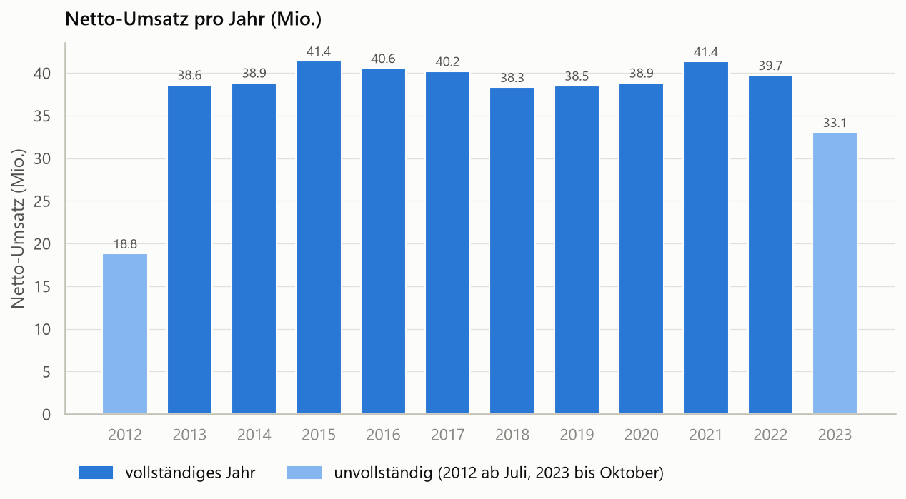
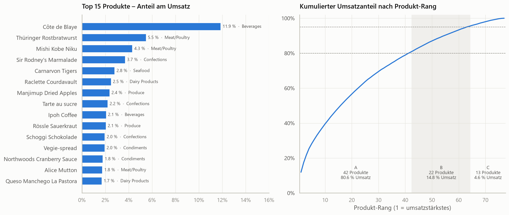
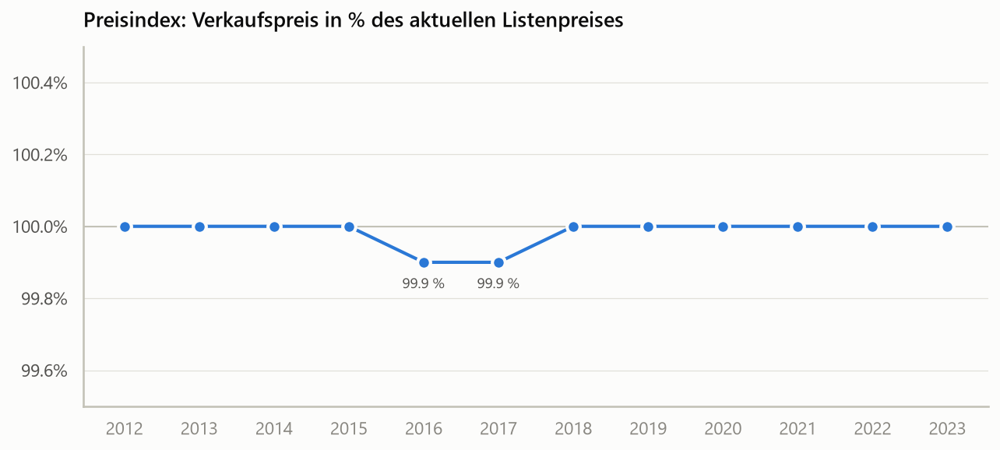
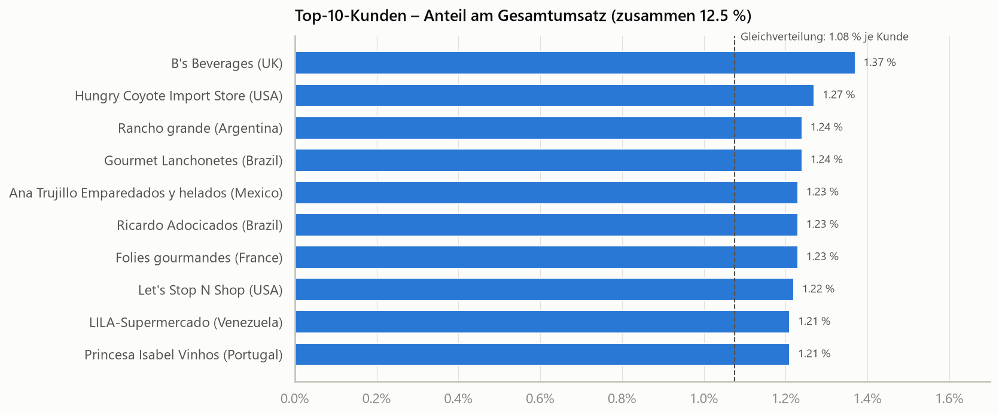
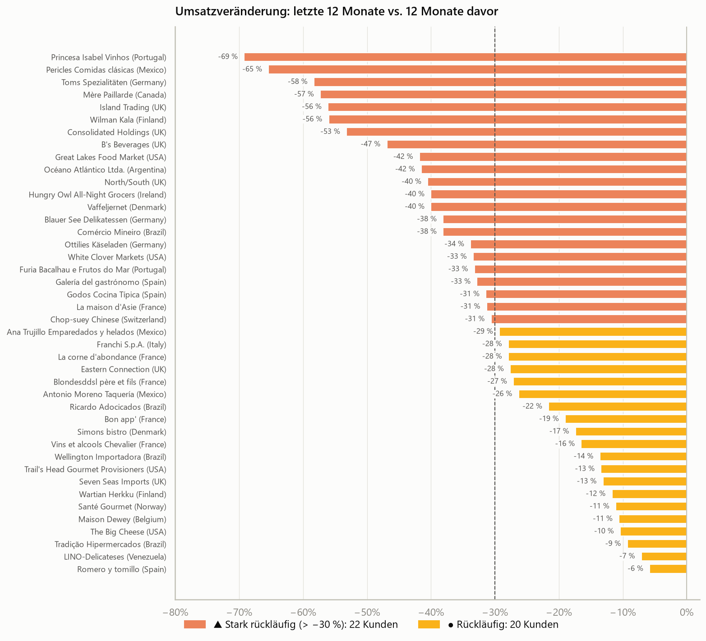
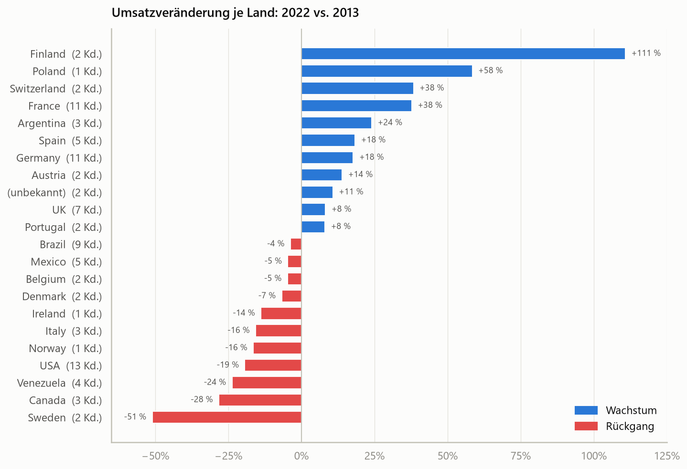
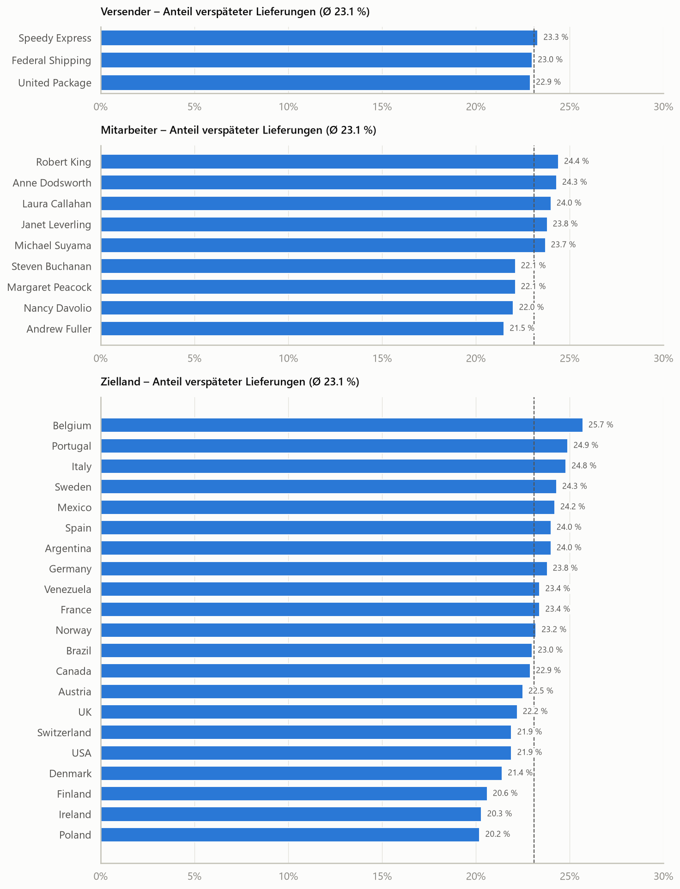
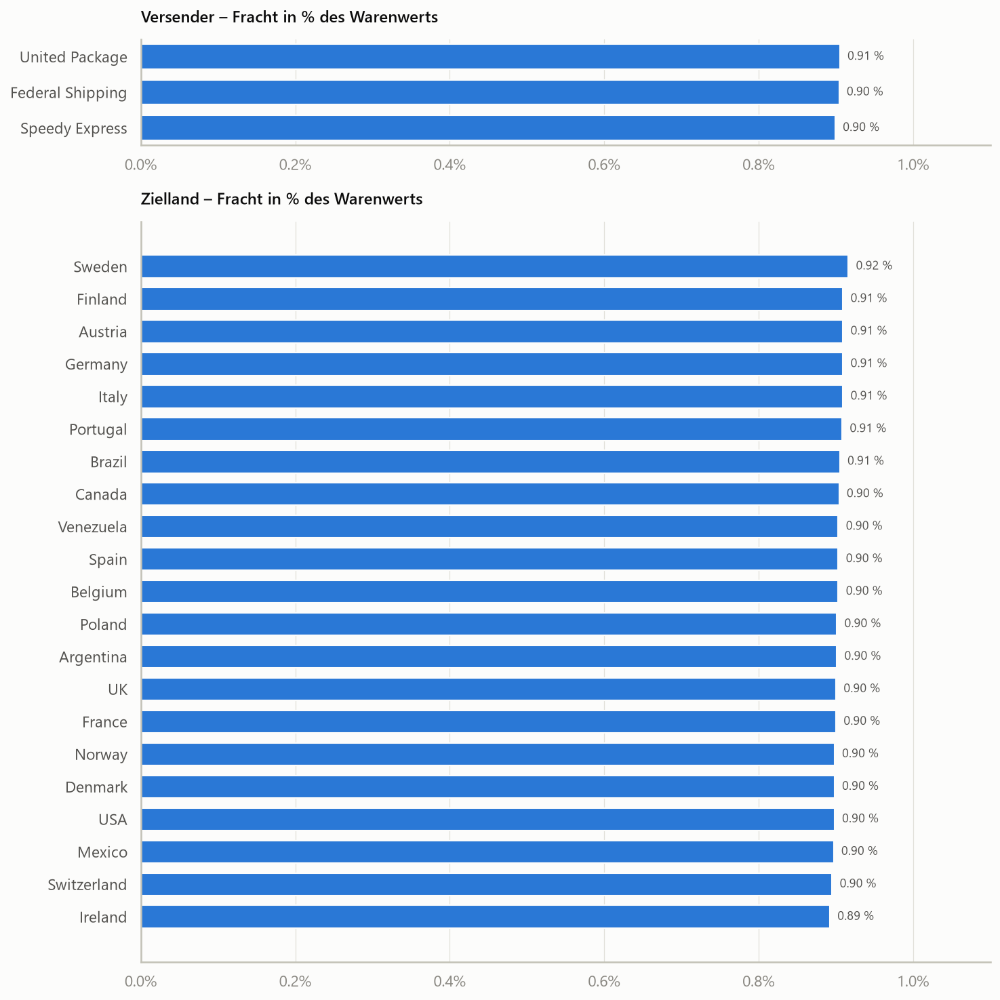
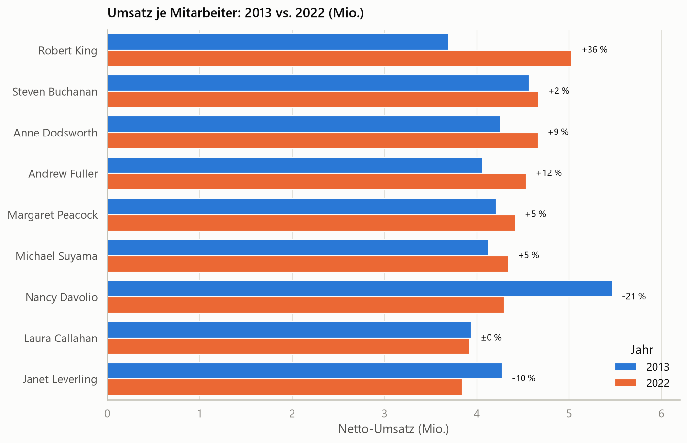
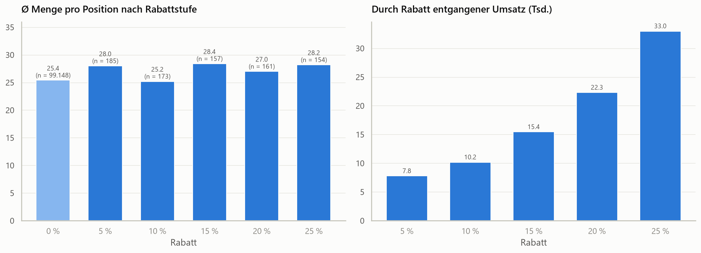

# Northwind – Business-Analyse

SQL-Analyse der Northwind-Datenbank (SQLite) entlang von 10 Business-Fragen, mit Diagrammen und Erkenntnissen.

> **Wichtig zu den Daten:** Die Datenbank `data/northwind_full.db` ist **synthetisch erweitert**: 16.282 Bestellungen
> von Juli 2012 bis Oktober 2023 statt der ~830 Original-Bestellungen. Viele Kennzahlen sind deshalb auffällig
> gleichmäßig. Die Methode ist auf echte Daten übertragbar, die konkreten Zahlen sind mit Vorsicht zu lesen.

## Die wichtigsten Erkenntnisse

| # | Frage | Erkenntnis |
|---|---|---|
| 1 | Umsatzentwicklung | **Stagnation:** 38–41 Mio. pro Jahr, über zehn Jahre (2013 → 2022) nur +2,9 % |
| 2 | Produkte (ABC) | **Côte de Blaye** bringt allein 11,9 % des Umsatzes; danach ist der Umsatz breit verteilt, für 80 % braucht es 42 von 77 Produkten |
| 3 | Preise | Verkauft wird praktisch immer zum Listenpreis; die Preispolitik ist mit diesen Daten nicht analysierbar |
| 4 | Top-Kunden | **Kein Klumpenrisiko:** Die Top 10 bringen zusammen nur 12,5 % des Umsatzes |
| 5 | Kundenabwanderung | **42 von 93 Kunden** kaufen weniger als im Vorjahr, 22 davon mehr als 30 % weniger |
| 6 | Länder | **Europa wächst, Amerika schrumpft:** Frankreich +38 %, Deutschland +18 %; USA −19 %, Kanada −28 % |
| 7 | Liefertreue | **23 % der Lieferungen sind verspätet**, und zwar überall gleich; die Ursache liegt im Prozess, nicht bei einzelnen Beteiligten |
| 8 | Frachtkosten | Die Fracht kostet überall ~0,9 % des Warenwerts und ist damit kein Hebel für die Marge |
| 9 | Mitarbeiter | Robert King +36 % (2022 die Nummer 1), Nancy Davolio −21 % (2013 noch die Nummer 1) |
| 10 | Rabatte | Mit Rabatt wird kaum mehr gekauft (25–28 vs. 25,4 Stück pro Position); Rabatte kosten vor allem Marge |

### Handlungsempfehlungen

1. **Liefertermine und Versandprozess prüfen.** Fast jede vierte Bestellung wird nach dem gewünschten Liefertermin versendet,
   im Schnitt rund 7 Tage zu spät. Da kein Versender, Mitarbeiter oder Land heraussticht, liegt die Ursache vermutlich
   in zu knapp gesetzten Terminen oder im Lager.
2. **Rückläufige Kunden ansprechen.** Die 22 Kunden mit mehr als −30 % zuerst, z. B. Princesa Isabel Vinhos (−69 %),
   Pericles Comidas clásicas (−65 %) und Toms Spezialitäten (−58 %). Pericles und Mère Paillarde haben seit Juli 2023
   nicht mehr bestellt.
3. **Amerika-Geschäft analysieren.** Die USA sind der größte Markt (14 % des Umsatzes) und verlieren seit 2013 ein Fünftel.
4. **Rabattpolitik überdenken.** Rabatte bringen kaum Mehrabsatz. Die Stichprobe ist allerdings klein
   (~830 rabattierte Positionen).
5. **Abhängigkeit von Côte de Blaye im Blick behalten.** Ein Lieferproblem bei diesem einen Produkt
   würde knapp 12 % des Umsatzes treffen.

## Diagramme

### 1. Umsatzentwicklung

2012 und 2023 sind unvollständige Jahre (hell dargestellt). 2023 liegt nach zehn Monaten 1,9 % über dem
Vorjahreszeitraum.

### 2. ABC-Analyse der Produkte

A: 42 Produkte (80,6 % des Umsatzes) · B: 22 Produkte (14,8 %) · C: 13 Produkte (4,6 %). Die C-Produkte sind
Kandidaten für eine Sortimentsprüfung.

### 3. Preisentwicklung

Der Preisindex liegt in allen Jahren bei 99,9–100 %. In zwölf Jahren gab es keine Preiserhöhung. Das ist ein Hinweis darauf,
dass die synthetischen Bestellungen mit den aktuellen Listenpreisen erzeugt wurden.

### 4. Top-Kunden

Der größte Kunde (B's Beverages, UK) hat 1,4 % Anteil, bei Gleichverteilung wären es 1,1 % je Kunde.

### 5. Kundenabwanderung

Vergleich der letzten 12 Monate (bis 28.10.2023) mit den 12 Monaten davor. Komplett verloren ist noch kein Kunde.

### 6. Länder

Bei Ländern mit nur 1–2 Kunden (z. B. Finnland +111 %, Schweden −51 %) bestimmt ein einzelner Kunde das Ergebnis.

### 7. Liefertreue

Die Verspätungsquoten liegen bei den Versendern zwischen 22,9 und 23,3 %, bei den Mitarbeitern zwischen 21,5 und 24,4 %
und bei den Zielländern zwischen 20,2 und 25,7 %.

### 8. Frachtkosten

Im Schnitt fallen ~249 Fracht bei ~27.500 Warenwert pro Bestellung an. Kein Versender und kein Zielland ist auffällig teurer.

### 9. Mitarbeiter

Über den gesamten Zeitraum liegen alle 9 Mitarbeiter bei 10,8–11,5 % Umsatzanteil. Auch der Vice President und
der Sales Manager verkaufen selbst so viel wie die Sales Representatives.

### 10. Rabatte

Der entgangene Umsatz steigt mit der Rabattstufe (5 %: ~7.800, 25 %: ~33.000), die Menge pro Position aber kaum.

## Einschränkungen der Daten

- **Synthetische Daten:** keine Saisonalität, Verspätungs- und Frachtquoten überall fast gleich, ein
  durchschnittlicher Bestellwert von ~28.000 ist unrealistisch.
- **2012 und 2023 sind unvollständig.** Jahresvergleiche nutzen deshalb 2013 vs. 2022.
- **Rabatte sind selten:** Nur 838 von 609.283 Positionen haben einen Rabatt.
- **Vermutlich Testdaten:** Die Kunden `Val2` und `VALON` (ohne Land) tragen ~2,2 % des Umsatzes; in den Länderauswertungen erscheinen sie als „(unbekannt)“.

## Projektstruktur

```
data/
  northwind_full.db     Vollständige Northwind-DB (Quelle: github.com/jpwhite3/northwind-SQLite3)
  Northwind.db          Vereinfachte W3Schools-Version (nur Altbestand)
sql/                    10 Abfragen, eine pro Business-Frage (01_… bis 10_…)
notebooks/
  01_analyse.ipynb      Führt alle Abfragen aus, zeigt Tabellen, Diagramme und Erkenntnisse
images/                 Diagramme als PNG
app.py                  Interaktives Streamlit-Dashboard (Filter: Jahr, Land, Kategorie)
requirements.txt        Python-Pakete
```

## Ausführen

Voraussetzungen: `sqlite3` und Python 3.14 (Windows).

### Daten herunterladen

Die Datenbank ist nicht im Repository enthalten, weil sie rund 25 MB groß ist. So lädst du sie herunter:

```powershell
New-Item -ItemType Directory -Force data
Invoke-WebRequest "https://raw.githubusercontent.com/jpwhite3/northwind-SQLite3/main/dist/northwind.db" -OutFile "data/northwind_full.db"
```

### Analyse ausführen

```powershell
# Umgebung einrichten
py -m venv .venv
.\.venv\Scripts\python.exe -m pip install -r requirements.txt

# Eine einzelne Abfrage ausführen
sqlite3 -header -column data/northwind_full.db ".read sql/01_umsatzentwicklung.sql"

# Interaktives Dashboard starten (öffnet http://localhost:8501)
.\.venv\Scripts\python.exe -m streamlit run app.py

# Notebook öffnen
.\.venv\Scripts\python.exe -m notebook notebooks\01_analyse.ipynb

# Notebook komplett neu ausführen (erzeugt auch die PNGs in images/ neu)
.\.venv\Scripts\python.exe -m nbconvert --to notebook --execute --inplace notebooks\01_analyse.ipynb
```

> Unter Windows mit aktivem **Smart App Control** wird `jupyter.exe` blockiert, deshalb werden alle
> Befehle über `python -m` gestartet. Aus demselben Grund ist pandas auf Version 2.3.3 festgelegt,
> weil 3.1.0 blockiert wird.

**Umsatzdefinition:** Netto-Umsatz = `UnitPrice × Quantity × (1 − Discount)` aus der Tabelle `[Order Details]`.
